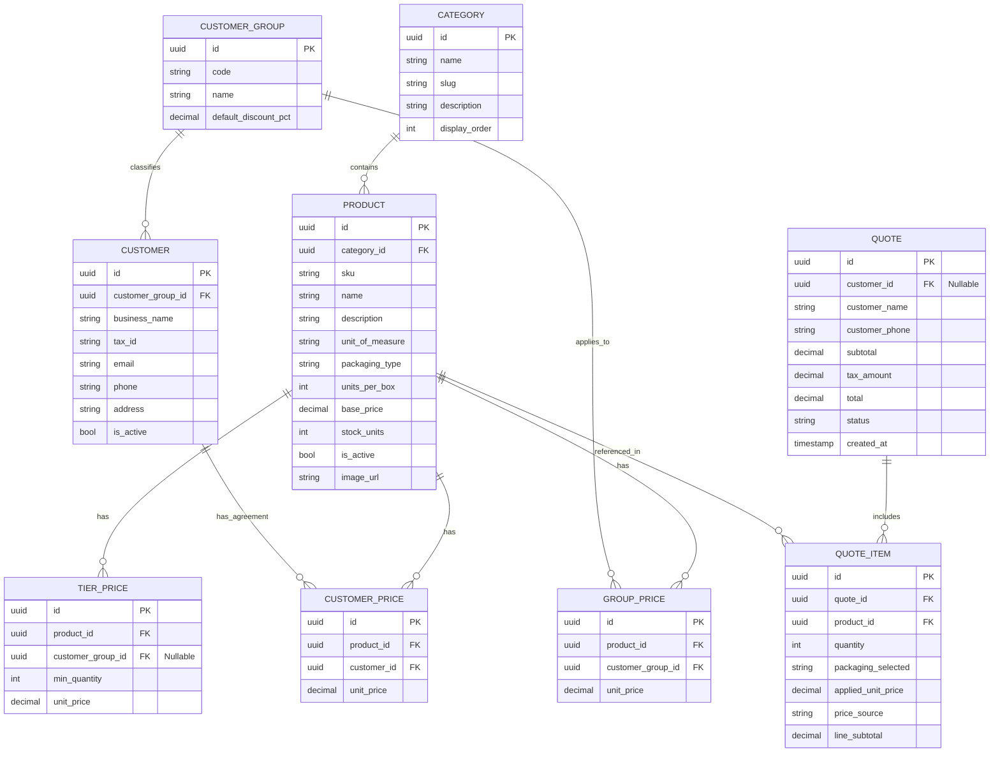

# Plan Técnico de Implementación: Gasbel B2B

**Documento**: `.specify/plan.md` | **Versión**: 1.0.0 | **Estado**: Aprobado para Implementación

---

## 1. Arquitectura de la Solución (.NET 9 / C# 13)

La solución se organizará bajo una arquitectura limpia modular:

```text
Gasbel-B2B/
├── src/
│   ├── Gasbel.Domain/                 # Entidades de dominio, Enums y reglas puras
│   │   ├── Entities/                  # Product, Customer, CustomerGroup, TierPrice, etc.
│   │   ├── Enums/                     # PackagingType, UnitOfMeasure, CustomerTier
│   │   └── Interfaces/                # IPricingStrategy, IRepository interfaces
│   ├── Gasbel.Application/              # Lógica de aplicación, casos de uso y DTOs
│   │   ├── Pricing/                   # Motor de cálculo de precios en cascada
│   │   ├── Products/                  # Queries y DTOs de catálogo
│   │   ├── Quotes/                    # Lógica del cotizador de pedidos
│   │   └── Common/                    # Validadores FluentValidation, mapeos
│   ├── Gasbel.Infrastructure/           # Acceso a datos y servicios externos
│   │   ├── Persistence/               # GasbelDbContext, EntityConfigurations
│   │   ├── Migrations/                # Migraciones EF Core 9 PostgreSQL
│   │   └── Seeders/                   # Seeder con catálogo real de 4 familias Gasbel
│   └── Gasbel.Web/                    # Minimal APIs y presentación interactiva
│       ├── Endpoints/                 # Minimal API routes con OpenAPI
│       ├── wwwroot/                   # Frontend estático Tailwind CSS + JS interactivo
│       └── Program.cs                 # Configuración de servicios, middleware y pipeline
└── tests/
    └── Gasbel.Tests/                  # Pruebas unitarias del motor de precios y reglas
```

---

## 2. Esquema de Base de Datos (PostgreSQL 16+)

### 2.1. Entidades Principales y Relaciones



---

## 3. Especificación de Endpoints (Minimal APIs & OpenAPI)

### 3.1. Catálogo de Productos
- `GET /api/categories`: Retorna la lista de categorías con cantidad de productos asociados.
- `GET /api/products`: Lista productos paginados con filtros opcionales (`categoryId`, `search`, `customerGroupId`, `customerId`). Retorna el precio resuelto para el contexto del usuario.
- `GET /api/products/{id}`: Detalle de producto incluyendo matriz de escalas de precio (`TierPrices`) y datos de empaque (`UnitsPerBox`, `PackagingType`).

### 3.2. Motor de Precios y Cotización
- `POST /api/pricing/calculate`:
  - **Input**: `{ productId: UUID, quantity: int, customerId?: UUID, customerGroupId?: UUID }`
  - **Output**: `{ unitPrice: decimal, subtotal: decimal, appliedSource: "TierPrice"|"CustomerPrice"|"GroupPrice"|"BasePrice", nextTierQuantity?: int, nextTierUnitPrice?: decimal, savingsPercentage: decimal }`
- `POST /api/quotes`:
  - **Input**: Datos del cliente y lista de ítems (`productId`, `quantity`, `packagingType`).
  - **Output**: Cotización consolidada con ID único, desglose línea por línea y resumen de totales.
- `GET /api/quotes/{id}`: Consulta de presupuesto generado para visualización o descarga.

---

## 4. Frontend y Experiencia de Usuario (UI B2B)

- **Tecnología:** HTML5 con Tailwind CSS integrado vía CDN o compilador, JavaScript moderno modular sin dependencias pesadas.
- **Componentes Clave:**
  1. **Barra de Contexto de Cliente:** Selector interactivo para simular el rol de compra (Minorista, Gastronómico, Distribuidor, Gran Cuenta) para auditar precios en vivo.
  2. **Tarjeta de Producto B2B:**
     - Toggle Paquete individual vs. Bulto cerrado.
     - Indicador dinámico de escala de precios según la cantidad ingresada.
     - Badge de descuento aplicado en tiempo real.
  3. **Drawer / Modal del Cotizador:**
     - Vista de presupuesto con cálculo de ahorro total mayorista.
     - Botón de generación de presupuesto con enlace para enviar a WhatsApp con mensaje preformateado.

---

## 5. Arquitectura de Persistencia en Producción y Despliegue Seguro (Docker)

### 5.1. Volúmenes Persistentes Obligatorios (`docker-compose.yml`)
- `./data:/app/data`: Almacena la base de datos relacional (`gasbel_b2b.db`), las reglas comerciales (`commercial_settings.json`), la grilla de clientes especiales (`special_clients.json`) y el maestro CSV sincronizado (`articulos_gasbel.csv`).
- `./uploads:/app/wwwroot/uploads`: Almacena todas las fotografías de artículos en `/app/wwwroot/uploads/products/`.

### 5.2. Resiliencia de Imágenes de Productos
- **Identificación determinista por SKU**: Los archivos de imagen se guardan como `{SanitizedSku}.{ext}` (ej. `/uploads/products/1415.jpg`), desacoplando la persistencia visual del `Guid` interno de la base de datos.
- **Reconciliación en arranque (`SyncProductImagesFromDiskAsync`)**: Durante el arranque de `Program.cs` y tras `POST /api/admin/import-csv`, el servicio verifica la integridad entre `wwwroot/uploads/products/` y la tabla `Products`, auto-vinculando cualquier imagen existente en disco por `Sku` o `Id`.

