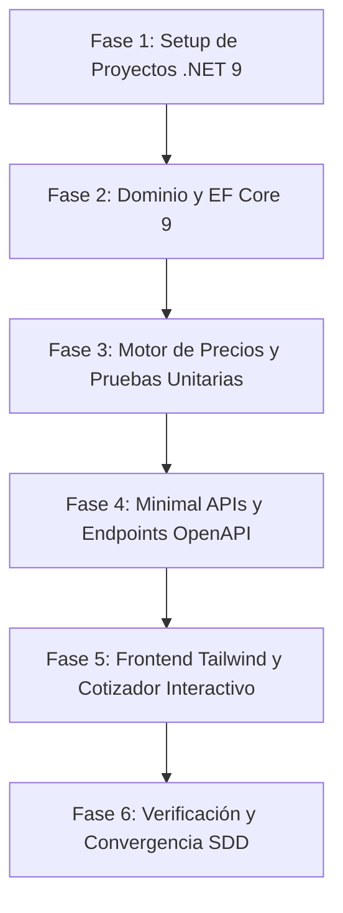

# Desglose de Tareas de Implementación: Gasbel B2B

**Documento**: `.specify/tasks.md` | **Versión**: 1.0.0 | **Estado**: Completado

---

## Roadmap de Tareas y Dependencias

---

### Fase 1: Setup de la Solución e Infraestructura Base
- [x] **T001**: Crear solución .NET 9 (`Gasbel.slnx`) y estructurar los proyectos modulares:
  - `src/Gasbel.Domain` (Class Library .NET 9)
  - `src/Gasbel.Application` (Class Library .NET 9)
  - `src/Gasbel.Infrastructure` (Class Library .NET 9)
  - `src/Gasbel.Web` (ASP.NET Core Web / Minimal API .NET 9)
  - `tests/Gasbel.Tests` (xUnit .NET 9)
- [x] **T002**: Instalar paquetes NuGet requeridos:
  - `Npgsql.EntityFrameworkCore.PostgreSQL` (v9.x)
  - `Microsoft.EntityFrameworkCore.Design` (v9.x)
  - `Microsoft.EntityFrameworkCore.Sqlite` (v9.x)
  - `FluentValidation.DependencyInjectionExtensions`
  - `Microsoft.AspNetCore.OpenApi` y `Scalar.AspNetCore`
- [x] **T003**: Configurar `appsettings.json` con cadena de conexión a PostgreSQL y soporte para SQLite en desarrollo local y pruebas automáticas.

---

### Fase 2: Modelo de Dominio, Persistencia y Seeders de Descartables
- [x] **T004**: Crear entidades y enumeraciones en `Gasbel.Domain`:
  - Enums: `PackagingType` (Paquete, Bulto, Fardo, Pallet), `UnitOfMeasure`, `CustomerGroupCode`.
  - Entidades: `Category`, `Product`, `CustomerGroup`, `Customer`, `TierPrice`, `GroupPrice`, `CustomerPrice`, `Quote`, `QuoteItem`.
- [x] **T005**: Configurar `GasbelDbContext` y mappings Fluent API con tipos de datos exactos (`decimal(18,2)`) e índices por SKU y Categoría.
- [x] **T006**: Crear seeder de datos con el catálogo real de las 4 familias de Gasbel:
  - 1: Bolsas (camiseta alta/baja densidad, arranque en rollo, consorcio pesadas, Kraft delivery).
  - 2: Envases térmicos y packaging (bandejas poliespuma EPS, aluminio con tapa, cajas pizza/empanadas, potes térmicos helado, salseros).
  - 3: Vasos, copas y cubiertos (vasos PP/PS, térmicos polipapel café con tapa, cubiertos plásticos reforzados, platos).
  - 4: Papelera comercial e higiene (film stretch virgen, film PVC gastronómico, servilletas bar/dispenser, bobinas Kraft, papel higiénico institucional).
  - Grupos de clientes predeterminados (Minorista, Comercio Gastronómico, Distribuidor / Reventa, Gran Cuenta) con matrices de precios y escalas de bulto cerrado.

---

### Fase 3: Motor de Precios B2B y Suite de Tests Unitarios
- [x] **T007**: Implementar `IPricingService` y `PricingService` con la cascada de resolución estricta:
  1. `TierPrice` (escala por cantidad / bultos)
  2. `CustomerPrice` (acuerdo individual)
  3. `GroupPrice` (grupo del cliente)
  4. `BasePrice` (lista minorista)
- [x] **T008**: Implementar cálculo de ahorro por escala y sugerencia de compra de bulto cerrado.
- [x] **T009**: Desarrollar suite completa de pruebas unitarias en `Gasbel.Tests`:
  - Test de resolución para cada escalón de la cascada.
  - Test de solapamiento entre grupo y volumen.
  - Test de validación de cantidades y redondeos monetarios.

---

### Fase 4: Endpoints Minimal APIs & OpenAPI
- [x] **T010**: Implementar endpoints de catálogo:
  - `GET /api/categories`: Listado de categorías con conteo de productos.
  - `GET /api/products`: Catálogo con filtros por categoría, búsqueda y resolución de precios por contexto de usuario.
  - `GET /api/products/{id}`: Detalle completo con matriz de precios por volumen.
- [x] **T011**: Implementar endpoint de cotización en tiempo real:
  - `POST /api/pricing/calculate`: Recibe producto, cantidad y cliente; retorna precio unitario, subtotal, fuente de precio aplicada y oportunidad de ahorro.
- [x] **T012**: Implementar endpoints de gestión de presupuestos:
  - `POST /api/quotes`: Creación de orden/cotización con desglose de ítems.
  - `GET /api/quotes/{id}`: Consulta y exportación de cotización generada.

---

### Fase 5: Frontend Web Interactivo con Tailwind CSS
- [x] **T013**: Crear interfaz principal de catálogo (`src/Gasbel.Web/wwwroot`):
  - Barra superior con selector de perfil comercial (Minorista, Comercio Gastronómico, Distribuidor, Gran Cuenta).
  - Filtros interactivos por familias de descartables y barra de búsqueda en tiempo real.
- [x] **T014**: Implementar tarjetas de producto interactivas:
  - Selector de unidades (Paquete vs. Bulto cerrado).
  - Recálculo dinámico de precio unitario y subtotal según cantidad ingresada.
  - Badge visual de ahorro cuando se activa una escala de precio mayorista.
- [x] **T015**: Implementar cotizador de pedidos:
  - Carrito / presupuesto lateral con detalle de ítems agregados.
  - Generación de resumen de cotización formal con IVA desglosado.
  - Botón de envío directo con mensaje preformateado para WhatsApp de ventas de Gasbel.

---

### Fase 6: Verificación, Pruebas y Convergencia SDD
- [x] **T016**: Compilación completa de la solución y ejecución de todos los tests automatizados (`dotnet test` pasó con 5/5 superados).
- [x] **T017**: Validación de correspondencia entre el catálogo de descartables del documento y los seeders generados.
- [x] **T018**: Verificación final de convergencia con GitHub Spec Kit.

---

### Fase 7: Requerimientos Comerciales de Cliente, Descuentos Especiales y Rediseño de Cotizador
- [x] **T019**: Modificar indicador de stock en cards: badge visual simplificado (verde con stock, gris sin stock) sin valores numéricos, permitiendo añadir al pedido en cualquier condición.
- [x] **T020**: Cambiar texto de botón de compra en cards de "Cotizar" a "Añadir".
- [x] **T021**: Implementar `CommercialSettings` y `CommercialSettingsService` con persistencia JSON para umbral de compra mínima de descuento mayorista ($50.000), umbral de envío gratis ($100.000) y números de WhatsApp (pruebas: 2613890532 vs producción: 2616799084).
- [x] **T022**: Implementar `SpecialDiscountClient` y endpoints CRUD para clientes con descuento especial (25%, 30%, etc.).
- [x] **T023**: Desarrollar pestañas de administración en vista ABM: Artículos, Clientes con Descuento Especial y Reglas Comerciales & WhatsApp.
- [x] **T024**: Implementar generación de enlaces personalizados (`?cliente={id}`) con botones de "Copiar Link" y envío directo por WhatsApp.
- [x] **T025**: Implementar detección automática de cliente vía URL, banner VIP de bienvenida y reflejo del precio con descuento en cada producto del catálogo.
- [x] **T026**: Rediseñar panel lateral de cotización (Drawer): scroll unificado, sticky footer para total y botones de acción permanentemente visibles.
- [x] **T027**: Implementar botón de maximizar / reducir pantalla completa en 2 columnas en el cotizador lateral.
- [x] **T028**: Integrar formulario previo al envío en cotizador con dirección del cliente, switch de entrega a domicilio y leyenda dinámica de envío gratis.
- [x] **T029**: Desarrollar suite de tests unitarios para `CommercialSettingsService` y verificar paso de 26/26 pruebas.

---

### Fase 8: Persistencia Inmutable de Imágenes, Base de Datos en Volumen Docker y Sincronización por SKU
- [x] **T030**: Mover cadena de conexión SQLite (`SqliteConnection`) hacia el volumen persistente `data/gasbel_b2b.db` en `appsettings.json`, `Program.cs` y `docker-compose.yml` (`/app/data/gasbel_b2b.db`), con migración automática si existía en la raíz.
- [x] **T031**: Guardar imágenes subidas o descargadas en `wwwroot/uploads/products/` nombradas por SKU sanitizado (`{sku}.{ext}`, ej. `1415.jpg`) y limpiar extensiones previas para evitar archivos huérfanos.
- [x] **T032**: Implementar `GasbelCsvImporter.SyncProductImagesFromDiskAsync` para auto-vincular imágenes físicas existentes en `wwwroot/uploads/products/` por SKU o ID en cada arranque e importación CSV.
- [x] **T033**: Configurar `GasbelCsvImporter` con modo `overwriteExisting: false` en el arranque (`Program.cs`) para no pisar ediciones manuales, precios ni artículos de prueba creados en el ABM al reiniciar el contenedor.
- [x] **T034**: Blindar `deploy.ps1`, `.gitignore` y `.dockerignore` para preservar la base de datos y carpeta de imágenes en cada despliegue en DigitalOcean.
- [x] **T035**: Agregar pruebas de integración en `CsvImporterIntegrationTests` validando la auto-vinculación de la imagen del artículo `1415` y la preservación de ediciones en reinicios.

