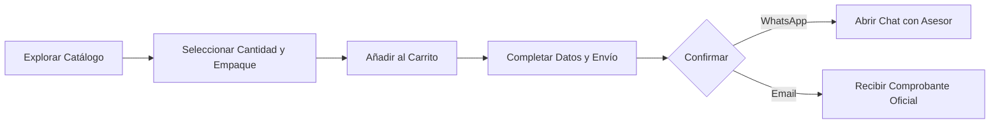

# 📦 Gasbel B2B · Manual de Uso y Documentación del Producto

**Versión:** 1.0 (Producción)  
**Dominio Oficial:** [https://gasbel.com.ar](https://gasbel.com.ar)  
**Destinatario:** Dirección Comercial y Equipo de Ventas · Gasbel Descartables y Perfumería  
**Fecha de Entrega:** Octubre de 2026  

---

## 🌟 1. Resumen Ejecutivo y Propuesta de Valor

**Gasbel B2B** es la nueva plataforma web oficial de catálogo y cotizaciones digitales desarrollada a medida para **Gasbel Descartables y Perfumería**. 

El sistema transforma la forma en que los clientes mayoristas y minoristas interactúan con la distribuidora:
* **Autonomía para el Cliente:** Los compradores pueden explorar todo el catálogo de descartables y perfumería, filtrar por rubros, comparar precios por unidad o por bulto cerrado, simular su compra y solicitar cotizaciones las 24 horas del día desde cualquier celular o computadora.
* **Cero Fricción en Ventas:** Elimina el envío manual de listas de precios desactualizadas en PDF o Excel. Los precios y bonificaciones se calculan en tiempo real.
* **Doble Canal de Cierre y Fidelización (WhatsApp + Correo Institucional):** El cliente recibe un comprobante formal en su correo y puede contactar al asesor comercial de Gasbel con 1 clic en WhatsApp con todo el pedido ya redactado.
* **Control Total para Gasbel:** Un panel de administración intuitivo permite ajustar montos mínimos, promociones de envío gratis, números de contacto y clientes especiales con descuentos exclusivos.

---

## 🏆 2. Logros y Funcionalidades Implementadas

A continuación se detallan los requerimientos comerciales y técnicos cumplidos e integrados en el sistema:

### A. Experiencia del Catálogo y Tarjetas de Producto
1. **Semáforo Visual de Stock (Disponibilidad sin números):**
   * Se reemplazó el número exacto de inventario por un indicador visual elegante: **Verde ("Disponible")** o **Gris ("Sin stock inmediato")**.
   * Esto protege la información confidencial de inventario del negocio y permite que los clientes puedan solicitar cotizaciones de igual manera si precisan mercadería a pedido.
2. **Visibilidad Transparente de Listas 1 y 2 en Simultáneo:**
   * Cada tarjeta de producto exhibe claramente el **Precio Minorista (Lista 1)** y el **Precio Mayorista (Lista 2)**.
   * El cliente visualiza de antemano el beneficio económico de comprar por volumen.
3. **Selector Dual de Empaque (Unidad / Paquete vs. Bulto Cerrado):**
   * El usuario puede elegir cotizar por paquetes individuales o por cajas/bultos cerrados.
   * Al seleccionar bulto cerrado, el sistema multiplica automáticamente la cantidad por las unidades reales por caja (ej. 1 caja = 120 unidades).
4. **Botón Dinámico de Acción:**
   * La tarjeta muestra el botón **"Añadir"** de forma predeterminada.
   * Si el producto ya está en el pedido, la tarjeta se resalta sutilmente, muestra la etiqueta `✓ En pedido: X u.` y el botón cambia automáticamente a **"Sumar más"**.

### B. Carrito de Compras y Cotizador Inteligente
1. **Persistencia Total del Pedido (`localStorage`):**
   * Los artículos agregados y los datos ingresados en el formulario (nombre, teléfono, dirección, email, notas) quedan guardados en el navegador del cliente.
   * Si el usuario recarga la página, cambia de pestaña o va a WhatsApp y vuelve, **nada se pierde**.
2. **Modo Pantalla Completa (Full-Screen) para el Carrito:**
   * El panel lateral de cotización cuenta con un botón en la esquina superior derecha (flecha de expansión) que permite agrandar el carrito a página completa para revisar pedidos voluminosos cómodamente.
3. **Botón de Vaciado Rápido:**
   * En la cabecera del carrito se incorporó el botón **"Vaciar"** (ícono de papelera) con confirmación, para reiniciar un pedido desde cero cuando el usuario lo desee.

### C. Reglas Comerciales Dinámicas y Descuentos Automáticos
1. **Umbral de Descuento Mayorista (Por defecto: $50.000):**
   * Si la compra supera el monto mínimo configurado, el sistema aplica automáticamente la tarifa mayorista (Lista 2) o bonificación correspondiente, reflejando el ahorro en verde en el comprobante final.
2. **Umbral de Envío Gratis (Por defecto: $100.000):**
   * En el formulario previo al envío, el cliente cuenta con un selector (switch) para solicitar **"Envío a Domicilio"** o **"Retiro en Local"**.
   * Se incluye la leyenda dinámica oficial: *"El envío es gratis a partir de $ 100.000,00"*. Si el pedido supera ese monto, el envío se marca automáticamente como **Gratis**.
   * Tanto el monto mínimo de descuento como el de envío gratis son modificables en cualquier momento desde el tablero de administración.

### D. Enlaces Exclusivos para Clientes Especiales (25% / 30% OFF)
1. **Grilla de Clientes Especiales en el Administrador:**
   * Permite dar de alta clientes preferenciales indicando su nombre, teléfono, dirección y su porcentaje de descuento específico (ej. Sandra Marzán 25%, Distribuidora Cuyo 30%).
2. **Generador de Enlaces Personalizados de 1 Clic:**
   * Cada cliente especial cuenta con un botón **"Copiar Link"**.
   * Al enviarle ese link al cliente (ej. por WhatsApp), cuando el cliente ingresa a la tienda, ve un **banner distintivo de bienvenida** anunciando su beneficio exclusivo (ej. *"Perfil activo: Sandra Marzán (25% OFF)"*).
   * Los descuentos especiales se calculan y aplican automáticamente sobre su compra.

### E. Doble Canal de Confirmación: WhatsApp + Email Institucional
1. **Enrutamiento Inteligente de WhatsApp (Móvil vs. PC):**
   * **En Celulares:** Al tocar *"Enviar a WhatsApp"*, abre directamente la app de WhatsApp con el mensaje pre-cargado, listo para enviar con 1 solo toque.
   * **En Computadoras:** Abre WhatsApp Web en una pestaña nueva y simultáneamente despliega en pantalla un **Modal de Asistencia Gasbel con Código QR Dinámico**. El cliente puede apuntar la cámara de su celular a la pantalla de la computadora y enviar el pedido desde su teléfono sin tener que iniciar sesión en WhatsApp Web en la PC.
   * Cuenta también con botón para **"Copiar Pedido"** al portapapeles.
2. **Sistema de Correo Institucional Automático (`@gasbel.com.ar`):**
   * Configurado con la plataforma profesional **Resend** y autenticación DNS oficial (SPF y DKIM verificados).
   * **Aviso Interno a Gasbel (`pedidos@gasbel.com.ar`):** Notificación inmediata con el resumen completo del pedido, datos del comprador y un botón verde: *"💬 Abrir WhatsApp con el Cliente"*.
   * **Comprobante al Cliente (si indicó email):** Recibe un correo con estética oficial Gasbel, membrete, desglose de artículos, subtotales, condición de entrega y un botón de contacto directo por WhatsApp.

---

## 📱 3. Guía de Uso para el Cliente (Paso a Paso)

1. **Ingreso al Catálogo:** El usuario ingresa a [https://gasbel.com.ar](https://gasbel.com.ar).
2. **Búsqueda y Filtros:** Puede tipear en el buscador (ej. *"vaso"*, *"detergente"*, *"bobina"*) o filtrar haciendo clic en las categorías (Descartables, Perfumería, Bolsas, etc.).
3. **Selección del Producto:**
   * Elige entre **"Por Paquete"** o **"Por Bulto Cerrado"**.
   * Define la cantidad deseada con los botones `+` / `-`.
   * Hace clic en **"Añadir"**.
4. **Revisión del Pedido:**
   * Abre el carrito haciendo clic en el botón flotante inferior o en el ícono de la bolsa arriba a la derecha.
   * Si desea más comodidad visual, toca la flecha de la esquina superior para verlo a **pantalla completa**.
5. **Datos de Contacto y Entrega:**
   * Completa su Nombre, Teléfono/WhatsApp y Dirección.
   * Activa o desactiva el switch de **"Solicitar Envío a Domicilio"**.
   * El sistema le indicará si califica para envío gratis o a coordinar según zona.
6. **Envío de la Cotización:**
   * Hace clic en **"Enviar a WhatsApp"** o **"Presupuesto"**.
   * El pedido se registra en el sistema, se emiten los correos y se abre la conversación con el comercio para coordinar el pago y despacho.

---

## 🛠️ 4. Guía de Uso para el Administrador de Gasbel

Para ingresar al panel de control, hacer clic en el botón **"Panel Admin"** en la barra superior.

### 4.1 Pestaña "Reglas Comerciales"
En este panel se configuran las políticas del negocio en tiempo real sin tocar código:
* **Monto Mínimo para Descuento Mayorista:** Monto a partir del cual se bonifica la compra (ej. `$ 50.000`).
* **Monto Mínimo para Envío Gratis:** Monto para bonificar el flete (ej. `$ 100.000`).
* **Leyenda de Envío Gratis:** Texto que verá el cliente antes de confirmar (ej. *"El envío es gratis a partir de "*).
* **Destino de WhatsApp para Cotizaciones:**
  * **Número Oficial / Producción:** Número real de ventas de Gasbel (`2616799084`).
  * **Número para Pruebas:** Número técnico de verificación (`2613890532`).
  * **Switch "Modo de Pruebas Activo":** Permite al equipo hacer pruebas internas sin molestar a los vendedores reales. Al pasar a producción, simplemente se apaga este switch.
* **Canales de Email Institucional:**
  * **Email de Recepción Gasbel:** Casilla donde llegan las órdenes (ej. `pedidos@gasbel.com.ar` o el mail del encargado).
  * **Switches de activación:** Permiten encender o apagar el envío a la empresa o al cliente con 1 clic.
* Al finalizar los cambios, hacer clic en **"Guardar Reglas Comerciales"**.

### 4.2 Pestaña "Clientes Especiales"
Diseñada para dar seguimiento a cuentas clave que tienen acuerdos comerciales personalizados:
1. Hacer clic en **"Nuevo Cliente Especial"**.
2. Ingresar el Nombre o Razón Social, Teléfono, Dirección y el **Porcentaje de Descuento** pactado (ej. `25` o `30`).
3. Guardar el registro.
4. En la grilla, hacer clic en el botón **"Copiar Link"**:
   * Ese enlace copiado (ej. `https://gasbel.com.ar/?cliente=XXXXXXXX`) se le envía por WhatsApp al cliente.
   * Cuando el cliente entre por ese link, la plataforma lo identificará y aplicará su descuento de forma automática en cada artículo cotizado.

### 4.3 Pestaña "Catálogo de Productos" (ABM)
* **Alta de Producto:** Permite registrar nuevos artículos con título, código SKU, dimensiones, capacidad, unidades por caja, precios de Lista 1 y Lista 2, y subir fotos desde la computadora o celular.
* **Edición Rápida:** Modificar precios, activar/desactivar productos o cambiar imágenes en segundos.
* **Importación Masiva desde Excel / CSV:** Permite actualizar de un solo golpe miles de artículos desde el archivo generado por el sistema de gestión contable.

---

## 🔒 5. Infraestructura y Seguridad Técnica

| Componente | Detalle de Implementación |
| :--- | :--- |
| **Dominio Web Oficial** | `https://gasbel.com.ar` y `https://www.gasbel.com.ar` |
| **Certificado de Seguridad** | Let's Encrypt SSL/TLS con cifrado de grado bancario (HTTPS) y renovación automática |
| **Servidor / Hosting** | Servidor VPS en la nube (DigitalOcean) ejecutando contenedores Docker de alta velocidad |
| **Servidor Web Reverso** | Nginx de alto rendimiento con soporte HTTP/2 y compresión Gzip |
| **Servicio de Correos** | Resend API integrada con registros DNS DKIM y SPF autenticados en NIC.ar y DigitalOcean |
| **Base de Datos** | Motor relacional transaccional con persistencia y respaldos automáticos |
| **Despliegues Futuros** | Automatización de 1 solo clic (`deploy.ps1`) para publicar actualizaciones sin caídas del servicio |

---

## 📞 6. Canales de Contacto y Soporte

* **Sitio Web:** [https://gasbel.com.ar](https://gasbel.com.ar)
* **WhatsApp Comercial:** +54 9 261 679-9084
* **WhatsApp Soporte / Pruebas:** +54 9 261 389-0532
* **Mendoza, Argentina**
